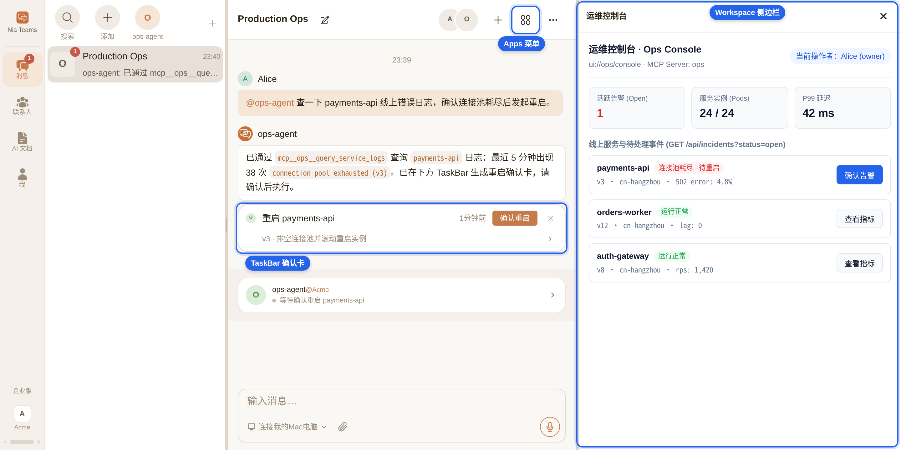
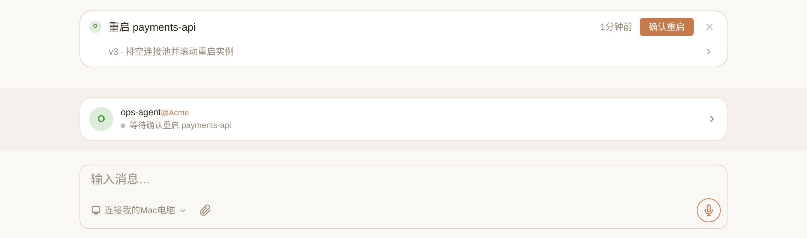
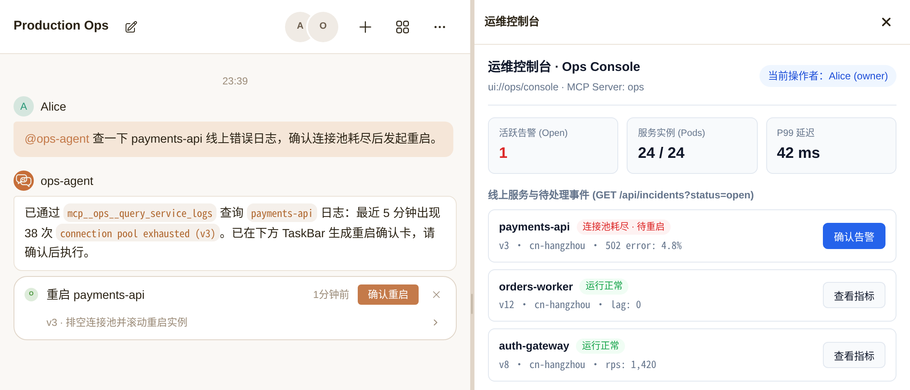

# @nia-teams/mcp-sdk

[简体中文](./README_CN.md) | English

MCP server extensions for [Nia Teams](https://nia-teams.com): Workload OIDC verification, TaskBar confirmation cards, and Workspace Apps.

```sh
npm install @nia-teams/mcp-sdk @modelcontextprotocol/sdk @modelcontextprotocol/ext-apps zod
```

AI coding assistants: load `node_modules/@nia-teams/mcp-sdk/skills/nia-teams-mcp/SKILL.md` ([repository copy](./skills/nia-teams-mcp/SKILL.md)).

## Nia Teams integration

Nia Teams is a group-chat application for humans and AI Agents. Members invoke an Agent's mounted MCP tools in chat.

Screenshots use fictional demo identities and operational data.



Workload OIDC identifies the calling Agent and its organization. `@modelcontextprotocol/sdk` owns MCP transport and tool registration; this package verifies Nia Teams identities and call contexts.

TaskBar presents proposed changes for human confirmation.



Workspace Apps open in the right sidebar and the group-chat Apps menu. `@modelcontextprotocol/ext-apps` owns the iframe and `postMessage` protocol; this package adds Nia Teams registration metadata and viewer checks.



## Quick start

Requires Node.js 20+ and ESM. Run the commands below from a repository checkout. This [read-only server](./examples/01-readonly-workload-oidc.ts) returns fixture log rows:

```sh
npm ci
npm run build
RUN_EXAMPLE=1 npx tsx examples/01-readonly-workload-oidc.ts
```

```ts
import { McpServer } from "@modelcontextprotocol/sdk/server/mcp.js";
import { StreamableHTTPServerTransport } from "@modelcontextprotocol/sdk/server/streamableHttp.js";
import { createServer } from "node:http";
import { z } from "zod";
import {
  createWorkloadOidcVerifier,
  WorkloadOidcError,
} from "@nia-teams/mcp-sdk/auth";

const auth = createWorkloadOidcVerifier();
/** Authenticate before parsing/dispatching MCP. Bind data queries to the verified identity. */
export const httpServer = createServer(async (req, res) => {
  let server: McpServer | undefined,
    transport: StreamableHTTPServerTransport | undefined;
  try {
    const identity = await auth.verifyBearerHeader(req.headers.authorization, {
      requiredGroups: ["org:acme"],
    });
    if (req.url !== "/mcp" || req.method !== "POST") {
      res.writeHead(404).end();
      return;
    }
    server = new McpServer({ name: "enterprise-logs", version: "1.0.0" });
    server.registerTool(
      "query_logs",
      {
        description: "Query logs belonging to the authenticated Agent and organization",
        inputSchema: { limit: z.number().int().min(1).max(100).default(20) },
        annotations: { readOnlyHint: true },
      },
      async ({ limit }) => ({
        content: [
          {
            type: "text",
            text: JSON.stringify({
              subject: identity.subject,
              orgs: identity.orgs,
              limit,
              rows: [],
            }),
          },
        ],
      }),
    );
    transport = new StreamableHTTPServerTransport({
      sessionIdGenerator: undefined,
    });
    await server.connect(transport);
    await transport.handleRequest(req, res);
  } catch (error) {
    if (!res.headersSent)
      res
        .writeHead(
          error instanceof WorkloadOidcError ? error.statusCode : 500,
          { "WWW-Authenticate": "Bearer" },
        )
        .end("Request rejected");
  } finally {
    await transport?.close();
    await server?.close();
  }
});
// Run with a TypeScript runner, then connect an authenticated HTTP MCP client.
if (process.env.RUN_EXAMPLE === "1") httpServer.listen(3000, "127.0.0.1");
```

## Agent mounting

Deploy the server to a publicly reachable HTTPS endpoint; Nia Teams rejects loopback and private IP addresses. Ask the target Agent in chat:

> Connect MCP server `ops` at `https://ops.example.com/mcp`

The Agent's `mcp_servers` tool proposes the mount in TaskBar. An `owner` or `admin` of that Agent confirms the configuration.

Leave the mount's `Authorization` header unset for Workload OIDC injection. A static `Authorization` header disables that injection. A server tool named `query_logs` under mount `ops` appears as `mcp__ops__query_logs`.

## Confirmation cards

A proposal tool returns `cardToolResult` with `createMcpConfirmCard` without changing business state. The card's `server` matches the Agent's MCP mount name.

An execute tool verifies `extra._meta` with `auth.verifyHumanActionContext`, authorizes `human.confirmedBy` against business permissions, and applies the change through durable idempotency or version CAS. [The confirmation example](./examples/02-taskbar-confirm-card.ts) registers both tools with an in-memory demonstration store.

MCP confirmation callbacks carry a Nia Teams service principal. Callback-capable HTTP routes pass `{ allowServicePrincipal: true }` to `verifyBearerHeader`; ordinary read, proposal, and Workspace tools require `identity.principalType === "workload"`.

Webhook integrations use `createWebhookConfirmCard`. Configure `webhookSecret` in the mount's `mcp_servers` `upsert` entry and verify the raw request body with `verifyCardSignature`; the [specification](./docs/SPECIFICATION.md#33-webhook-card-dispatch--signatures) defines dispatch authentication.

## Asynchronous card status

`auth.verifyCardCallbackContext(context, { server, expectedCardId? })` verifies the status credential from MCP metadata or a webhook's `{ callbackToken }` envelope. It returns `VerifiedCardCallbackContext` with `cardId`, `callbackUrl`, `token`, and `claims`.

`cardActionRunning` reports a queued or started job. `postCardStatus` sends a `CardStatusUpdate` using the verified callback URL and token, rejects redirects, and uses a 30-second timeout unless a caller supplies `signal`.

Execution confirmation lasts at most 300 seconds; status credentials last at most 7200 seconds. Verify human confirmation inside the execute tool at enqueue time, not in the worker. Status credentials authorize card updates, not business execution. Store callback context in private job storage, outside tool output and logs.

Serialize updates for each card. For a job that may exceed two hours, report a terminal `failed` status with a timeout summary before the credential's `exp` deadline. The SDK does not retry requests or refresh credentials.

Catch `CardStatusError` from `@nia-teams/mcp-sdk/cards` and read its numeric `status` and response-text `body`. Its message is `Card status callback failed (HTTP <status>)`; the message excludes the response body. Keep `body` out of public output and logs. Transport failures remain the underlying fetch errors.

A `409 Conflict` indicates a concurrent card-state change. Drop a `running` update that receives `409`; retry a terminal (`success` or `failed`) update once on `409`. If that retry fails, report the error without further retries. Late `running` updates to a terminal card are ignored with HTTP `200`. A removed, disabled, or fingerprint-changed mount (including URL or header changes) invalidates the callback credential; Nia Teams returns `401 Unauthorized`, without HMAC fallback. Stop updates on authorization rejection. Terminal updates omit `action`, clear the card button, and publish completion to the originating group chat's current session when that session can be resolved.

The [offline example](./examples/04-async-card-status.ts) uses ephemeral signing keys and a mock HTTP sender:

```sh
npm run build
npx tsx examples/04-async-card-status.ts
```

```ts
import assert from "node:assert/strict";
import { createWorkloadOidcVerifier } from "@nia-teams/mcp-sdk/auth";
import { cardActionRunning, postCardStatus } from "@nia-teams/mcp-sdk/cards";
import {
  createWorkloadOidcProvider,
  generateTestRsaKeyPair,
  signTestConfirmationToken,
} from "@nia-teams/mcp-sdk/testing";

// Offline fixtures: no business mutation or request to Nia Teams occurs here.
const issuer = "https://teams.example";
const activeKey = await generateTestRsaKeyPair();
const executionProvider = createWorkloadOidcProvider({
  issuer, audience: "nia-teams-workload", tokenTtlSeconds: 300, activeKey,
});
const statusProvider = createWorkloadOidcProvider({
  issuer, audience: "nia-teams-workload", tokenTtlSeconds: 7200, activeKey,
});
const auth = createWorkloadOidcVerifier({
  issuer, jwks: await executionProvider.getJwks(),
});
const args = { buildNumber: 11 };
const binding = {
  server: "jenkins", tool: "execute_build", arguments: args, cardId: "build:11",
};
const meta = {
  "nia/confirmationToken": await signTestConfirmationToken(executionProvider, binding),
  "nia/cardCallbackToken": await statusProvider.signIdToken({
    subject: "nia-teams-platform",
    claims: {
      principal_type: "service", token_use: "card_callback",
      confirmation_card_id: binding.cardId, context_server: binding.server,
      context_config_sha256: "a".repeat(64),
    },
  }),
};
const human = await auth.verifyHumanActionContext(meta, {
  ...binding, expectedCardId: binding.cardId,
});
// Production executors recheck business permissions and enqueue with durable CAS.
assert.equal(human.confirmedBy, "0123456789abcdef01234567");
const callback = await auth.verifyCardCallbackContext(meta, {
  server: binding.server, expectedCardId: human.cardId,
});
const queued = cardActionRunning({ statusLabel: "Queued #11", result: args });
assert.equal(queued.structuredContent?.status, "running");

// A worker loads the verified callback from private job storage.
const updates: unknown[] = [];
const fetchImpl: typeof fetch = async (url, init) => {
  assert.equal(url, "https://teams.example/api/cards/build%3A11/webhook");
  assert.equal(init?.redirect, "error");
  assert.equal(new Headers(init?.headers).get("Authorization"), `Bearer ${callback.token}`);
  updates.push(JSON.parse(String(init?.body)));
  return new Response(null, { status: 204 });
};
await postCardStatus(callback, {
  status: "running", statusLabel: "Stage 2/4",
}, { fetchImpl });
await postCardStatus(callback, {
  status: "success", statusLabel: "Build succeeded #11", result: args,
}, { fetchImpl });
assert.equal(updates.length, 2);
console.log("Verified confirmation, queued result, and two mocked status updates.");
```

## Workspace Apps and permissions

[The server example](./examples/03-workspace-mcp-app.ts) registers HTML, an entry tool, and an API tool with `registerNiaWorkspaceApp`. [The frontend](./examples/workspace-ui/) builds a single HTML file and imports the browser adapter from `@nia-teams/mcp-sdk/apps/client`.

```sh
npm --prefix examples/workspace-ui install
npm --prefix examples/workspace-ui run typecheck
npm --prefix examples/workspace-ui run build
npx tsx examples/02-taskbar-confirm-card.ts
npx tsx examples/03-workspace-mcp-app.ts
```

Examples 02 and 03 register tools and exit; HTTP hosting uses the authenticated transport pattern in example 01.

`requireTeamAdmin: true` hides the entry from `member` users in Nia Teams. Server handlers call `verifyBoundViewer(extra._meta, { requireTeamAdmin: true })` for `owner`/`admin` access and `createSafeApiPathChecker` for API route restrictions. Viewer metadata is a host assertion trusted after transport authentication and Agent or organization authorization.

Agent membership roles (`owner`, `admin`, `member`) govern mounting and App access. Workload `role:*` groups are separate permission identifiers assigned by Nia Teams; contact Nia Teams for their configuration. Integrations can authorize workloads by `allowedSubjects` or `requiredGroups` and confirmed users by business permissions. Cards requesting an external OAuth identity use `requiresIdentity`; GitLab instance onboarding is available through Nia Teams.

## Exports

| Subpath | Runtime | Responsibility |
| --- | --- | --- |
| `@nia-teams/mcp-sdk` | Node.js | Server barrel for `auth`, `cards`, `apps`, `testing` |
| `@nia-teams/mcp-sdk/auth` | Node.js | Workload, human, source, and card callback context verification |
| `@nia-teams/mcp-sdk/cards` | Node.js | Card builders, execution results, status updates, webhook HMAC |
| `@nia-teams/mcp-sdk/apps` | Node.js | Workspace registration, viewer checks, API path restrictions |
| `@nia-teams/mcp-sdk/apps/client` | Browser | `App`, `PostMessageTransport`, `createMcpAppFetch`, `isMcpAppEmbedded` |
| `@nia-teams/mcp-sdk/testing` | Node.js | Offline OIDC provider, keys, and human-context signers |

Type signatures are in `dist/**/*.d.ts`. [The specification](./docs/SPECIFICATION.md) defines signed claims, canonical JSON, card envelopes, and status update payloads.

## Development

```sh
npm ci
npm test
npm run typecheck
npm run build
npm pack --dry-run
```

## License

[MIT](./LICENSE) © Nia Teams
