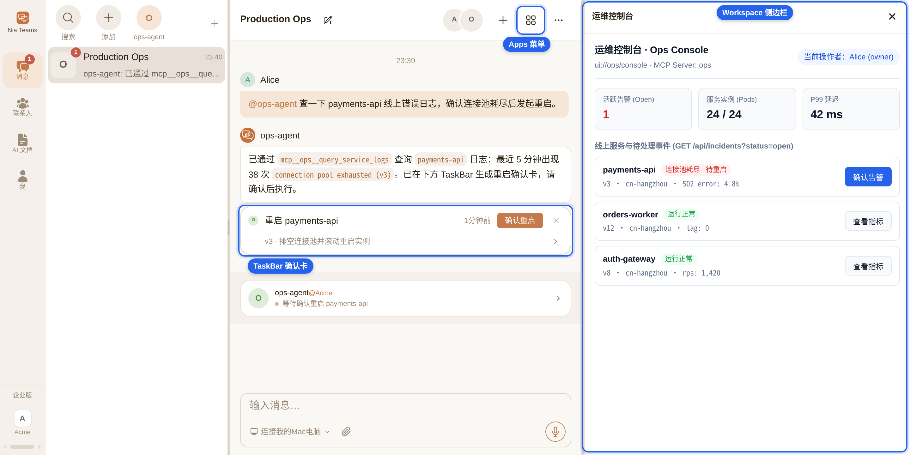
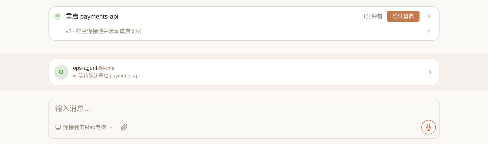
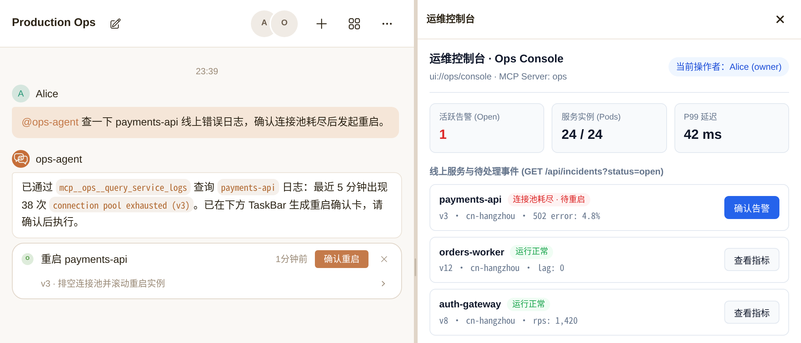

# @nia-teams/mcp-sdk

[English](./README.md) | 简体中文

面向 [Nia Teams](https://nia-teams.com) 的 MCP 服务端扩展：Workload OIDC 验签、TaskBar 确认卡与工作区应用。

```sh
npm install @nia-teams/mcp-sdk @modelcontextprotocol/sdk @modelcontextprotocol/ext-apps zod
```

AI 编程助手加载 `node_modules/@nia-teams/mcp-sdk/skills/nia-teams-mcp/SKILL.md`（[仓库副本](./skills/nia-teams-mcp/SKILL.md)）。

## 群聊接入

Nia Teams 是人与 AI Agent 协作的群聊应用，成员通过 Agent 调用已挂载的 MCP 工具。

截图使用虚构身份与演示数据。



Workload OIDC 标识调用方 Agent 及其所属组织。`@modelcontextprotocol/sdk` 负责 MCP 传输与工具注册，本包负责 Nia Teams 身份和调用上下文校验。

TaskBar 展示等待成员确认的操作卡片。



工作区应用在右侧边栏和群聊应用菜单中打开。`@modelcontextprotocol/ext-apps` 负责 iframe 与 `postMessage` 协议，本包提供 Nia Teams 注册元数据和访问者校验。



## 快速开始

运行环境为 Node.js 20+ 与 ESM，以下命令在仓库目录中运行。[只读服务示例](./examples/01-readonly-workload-oidc.ts)返回演示日志：

```sh
npm ci
npm run build
RUN_EXAMPLE=1 npx tsx examples/01-readonly-workload-oidc.ts
```

```ts
import { McpServer } from "@modelcontextprotocol/sdk/server/mcp.js";
import { StreamableHTTPServerTransport } from "@modelcontextprotocol/sdk/server/streamableHttp.js";
import { createServer } from "node:http";
import { z } from "zod";
import {
  createWorkloadOidcVerifier,
  WorkloadOidcError,
} from "@nia-teams/mcp-sdk/auth";

const auth = createWorkloadOidcVerifier();
/** Authenticate before parsing/dispatching MCP. Bind data queries to the verified identity. */
export const httpServer = createServer(async (req, res) => {
  let server: McpServer | undefined,
    transport: StreamableHTTPServerTransport | undefined;
  try {
    const identity = await auth.verifyBearerHeader(req.headers.authorization, {
      requiredGroups: ["org:acme"],
    });
    if (req.url !== "/mcp" || req.method !== "POST") {
      res.writeHead(404).end();
      return;
    }
    server = new McpServer({ name: "enterprise-logs", version: "1.0.0" });
    server.registerTool(
      "query_logs",
      {
        description: "Query logs belonging to the authenticated Agent and organization",
        inputSchema: { limit: z.number().int().min(1).max(100).default(20) },
        annotations: { readOnlyHint: true },
      },
      async ({ limit }) => ({
        content: [
          {
            type: "text",
            text: JSON.stringify({
              subject: identity.subject,
              orgs: identity.orgs,
              limit,
              rows: [],
            }),
          },
        ],
      }),
    );
    transport = new StreamableHTTPServerTransport({
      sessionIdGenerator: undefined,
    });
    await server.connect(transport);
    await transport.handleRequest(req, res);
  } catch (error) {
    if (!res.headersSent)
      res
        .writeHead(
          error instanceof WorkloadOidcError ? error.statusCode : 500,
          { "WWW-Authenticate": "Bearer" },
        )
        .end("Request rejected");
  } finally {
    await transport?.close();
    await server?.close();
  }
});
// Run with a TypeScript runner, then connect an authenticated HTTP MCP client.
if (process.env.RUN_EXAMPLE === "1") httpServer.listen(3000, "127.0.0.1");
```

## 挂载配置

服务使用公网可达的 HTTPS 地址，Nia Teams 不接受回环地址与私网地址。在群聊中向目标 Agent 发送：

> 连接名为 `ops` 的 MCP 服务，地址为 `https://ops.example.com/mcp`

Agent 的 `mcp_servers` 工具在 TaskBar 中提出挂载配置，由该 Agent 的 `owner` 或 `admin` 确认。

挂载配置中的 `Authorization` 请求头留空时，Nia Teams 注入 Workload OIDC 凭证；静态 `Authorization` 请求头会停用该注入。挂载名称为 `ops` 时，服务端的 `query_logs` 工具在 Agent 侧显示为 `mcp__ops__query_logs`。

## 确认卡

提议工具通过 `cardToolResult` 与 `createMcpConfirmCard` 返回确认卡，不修改业务状态。卡片的 `server` 与 Agent 的 MCP 挂载名称一致。

执行工具通过 `auth.verifyHumanActionContext` 校验 `extra._meta`，根据 `human.confirmedBy` 检查业务权限，并通过持久化幂等记录或版本 CAS 执行变更。[确认卡示例](./examples/02-taskbar-confirm-card.ts)使用内存演示存储注册这两个工具。

MCP 确认回调携带 Nia Teams 服务身份。接收回调的 HTTP 路由向 `verifyBearerHeader` 传入 `{ allowServicePrincipal: true }`；普通只读、提议和工作区工具要求 `identity.principalType === "workload"`。

Webhook 接入使用 `createWebhookConfirmCard`。挂载配置的 `mcp_servers` `upsert` 项通过 `webhookSecret` 设置密钥，接收方通过 `verifyCardSignature` 校验原始请求体。[协议规范](./docs/SPECIFICATION.md#33-webhook-card-dispatch--signatures)定义回调鉴权方式。

## 异步卡片状态

`auth.verifyCardCallbackContext(context, { server, expectedCardId? })` 校验 MCP 元数据或 Webhook `{ callbackToken }` 中的状态凭证，返回包含 `cardId`、`callbackUrl`、`token`、`claims` 的 `VerifiedCardCallbackContext`。

`cardActionRunning` 返回已入队或已启动的作业状态。`postCardStatus` 使用已验证的回调地址与凭证发送 `CardStatusUpdate`，拒绝重定向，未传入 `signal` 时采用 30 秒超时。

执行确认的有效期上限为 300 秒，状态凭证的有效期上限为 7200 秒。请在执行工具入队时校验人工确认上下文，不要延迟到工作进程中校验。状态凭证仅授权卡片更新，不授权业务执行。将回调上下文存入作业私有存储，不回显到工具输出或日志。

串行发送同一张卡片的状态更新。若作业可能超过两小时，请在凭证的 `exp` 截止时间前发送终态 `failed` 和超时摘要。SDK 不提供请求重试或凭证刷新。

从 `@nia-teams/mcp-sdk/cards` 导入并捕获 `CardStatusError`，读取数字属性 `status` 和响应文本属性 `body`。错误消息格式为 `Card status callback failed (HTTP <status>)`，消息不包含响应正文。不要将 `body` 回显到公开输出或日志。传输失败仍抛出 fetch 原始错误。

`409 Conflict` 表示卡片状态发生并发变更。收到 `409` 时，请丢弃该次 `running` 更新；终态（`success` 或 `failed`）更新请重试一次。若该次重试仍失败，请报告错误，不再重试。已处于终态的卡片收到迟到的 `running` 更新时返回 HTTP `200`，不修改状态。挂载被移除、停用或指纹变更（含 URL 或请求头变更）会使回调凭证失效；Nia Teams 返回 `401 Unauthorized`，不回退到 HMAC。收到鉴权拒绝后请停止更新。终态更新不发送 `action`，Nia Teams 会清除卡片按钮，并在来源群聊的当前会话可解析时投递完成事件。

[离线示例](./examples/04-async-card-status.ts)使用临时签名密钥和模拟 HTTP 发送器：

```sh
npm run build
npx tsx examples/04-async-card-status.ts
```

```ts
import assert from "node:assert/strict";
import { createWorkloadOidcVerifier } from "@nia-teams/mcp-sdk/auth";
import { cardActionRunning, postCardStatus } from "@nia-teams/mcp-sdk/cards";
import {
  createWorkloadOidcProvider,
  generateTestRsaKeyPair,
  signTestConfirmationToken,
} from "@nia-teams/mcp-sdk/testing";

// Offline fixtures: no business mutation or request to Nia Teams occurs here.
const issuer = "https://teams.example";
const activeKey = await generateTestRsaKeyPair();
const executionProvider = createWorkloadOidcProvider({
  issuer, audience: "nia-teams-workload", tokenTtlSeconds: 300, activeKey,
});
const statusProvider = createWorkloadOidcProvider({
  issuer, audience: "nia-teams-workload", tokenTtlSeconds: 7200, activeKey,
});
const auth = createWorkloadOidcVerifier({
  issuer, jwks: await executionProvider.getJwks(),
});
const args = { buildNumber: 11 };
const binding = {
  server: "jenkins", tool: "execute_build", arguments: args, cardId: "build:11",
};
const meta = {
  "nia/confirmationToken": await signTestConfirmationToken(executionProvider, binding),
  "nia/cardCallbackToken": await statusProvider.signIdToken({
    subject: "nia-teams-platform",
    claims: {
      principal_type: "service", token_use: "card_callback",
      confirmation_card_id: binding.cardId, context_server: binding.server,
      context_config_sha256: "a".repeat(64),
    },
  }),
};
const human = await auth.verifyHumanActionContext(meta, {
  ...binding, expectedCardId: binding.cardId,
});
// Production executors recheck business permissions and enqueue with durable CAS.
assert.equal(human.confirmedBy, "0123456789abcdef01234567");
const callback = await auth.verifyCardCallbackContext(meta, {
  server: binding.server, expectedCardId: human.cardId,
});
const queued = cardActionRunning({ statusLabel: "Queued #11", result: args });
assert.equal(queued.structuredContent?.status, "running");

// A worker loads the verified callback from private job storage.
const updates: unknown[] = [];
const fetchImpl: typeof fetch = async (url, init) => {
  assert.equal(url, "https://teams.example/api/cards/build%3A11/webhook");
  assert.equal(init?.redirect, "error");
  assert.equal(new Headers(init?.headers).get("Authorization"), `Bearer ${callback.token}`);
  updates.push(JSON.parse(String(init?.body)));
  return new Response(null, { status: 204 });
};
await postCardStatus(callback, {
  status: "running", statusLabel: "Stage 2/4",
}, { fetchImpl });
await postCardStatus(callback, {
  status: "success", statusLabel: "Build succeeded #11", result: args,
}, { fetchImpl });
assert.equal(updates.length, 2);
console.log("Verified confirmation, queued result, and two mocked status updates.");
```

## 工作区应用与权限

[服务端示例](./examples/03-workspace-mcp-app.ts)通过 `registerNiaWorkspaceApp` 注册 HTML、入口工具和 API 工具。[前端工程](./examples/workspace-ui/)构建单文件 HTML，从 `@nia-teams/mcp-sdk/apps/client` 导入浏览器适配器。

```sh
npm --prefix examples/workspace-ui install
npm --prefix examples/workspace-ui run typecheck
npm --prefix examples/workspace-ui run build
npx tsx examples/02-taskbar-confirm-card.ts
npx tsx examples/03-workspace-mcp-app.ts
```

示例 02、03 在注册工具后退出，HTTP 托管采用示例 01 的鉴权传输方式。

`requireTeamAdmin: true` 在 Nia Teams 中对 `member` 隐藏应用入口。服务端处理器通过 `verifyBoundViewer(extra._meta, { requireTeamAdmin: true })` 校验 `owner`/`admin` 权限，通过 `createSafeApiPathChecker` 限制 API 路径。访问者元数据属于宿主声明，接收方先校验传输身份与 Agent 或组织权限。

Agent 成员角色（`owner`、`admin`、`member`）管理挂载与应用访问。Workload 的 `role:*` 分组是 Nia Teams 分配的权限标识，配置方式可联系 Nia Teams。接入方通过 `allowedSubjects` 或 `requiredGroups` 授权调用方，通过业务权限授权确认人。需要外部 OAuth 身份的卡片声明 `requiresIdentity`，GitLab 实例接入可联系 Nia Teams。

## 导出入口

| 子路径 | 运行环境 | 职责 |
| --- | --- | --- |
| `@nia-teams/mcp-sdk` | Node.js | 聚合导出 `auth`、`cards`、`apps`、`testing` |
| `@nia-teams/mcp-sdk/auth` | Node.js | 校验调用方、确认人、来源和卡片回调上下文 |
| `@nia-teams/mcp-sdk/cards` | Node.js | 卡片构建、执行结果、状态更新与 Webhook HMAC |
| `@nia-teams/mcp-sdk/apps` | Node.js | 工作区注册、访问者校验与 API 路径限制 |
| `@nia-teams/mcp-sdk/apps/client` | 浏览器 | `App`、`PostMessageTransport`、`createMcpAppFetch`、`isMcpAppEmbedded` |
| `@nia-teams/mcp-sdk/testing` | Node.js | 离线 OIDC 签发器、密钥和确认上下文签发函数 |

类型签名见 `dist/**/*.d.ts`。[协议规范](./docs/SPECIFICATION.md)定义签名声明、canonical JSON、卡片结构和状态更新报文。

## 本地验证

```sh
npm ci
npm test
npm run typecheck
npm run build
npm pack --dry-run
```

## 开源协议

[MIT](./LICENSE) © Nia Teams
